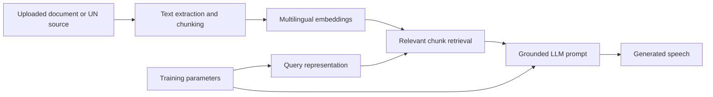
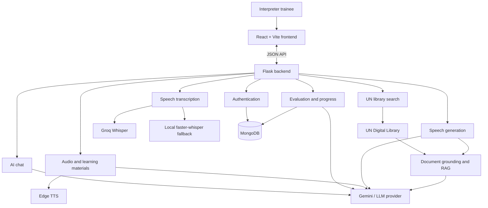

<h1 align="center">ETIB — AI Interpreter Trainer</h1>

<p align="center">
  An AI-powered multilingual platform for conference interpretation training,
  automated speech assessment and personalized learning.
</p>

<p align="center">
  
  
  
  
  
  
  
  
</p>

<p align="center"><strong>English · French · Arabic</strong></p>

<p align="center">
  <a href="https://etib-interpreter-trainer.vercel.app">Live Demo</a>
  · <a href="docs/ETIB_Technical_Documentation.pdf">Technical Documentation</a>
  · <a href="docs/ETIB_User_Guide.pdf">User Guide</a>
</p>

<p align="center">
  <a href="https://www.unige.ch/fti/Inttech100/">
    
  </a>
  <a href="https://cinia.blogs.usj.edu.lb/2026/10/de-beyrouth-a-geneve-lusj-innove-dans-la-formation-des-interpretes-grace-a-lia/">
    
  </a>
  <a href="https://www.lorientlejour.com/article/1550062/comprendre-avant-dutiliser-a-letib-un-du-pour-placer-les-linguistes-au-coeur-de-lia.html">
    
  </a>
</p>

---

## Overview

Conference interpretation requires more than language proficiency: interpreters must listen, process information, retain terminology and accurately convey meaning in real time. Independent practice is particularly challenging when learners lack realistic training materials and timely, detailed feedback.

**ETIB Interpreter Trainer** brings the complete training workflow into a single web application. Learners can generate realistic conference speeches or work from source documents, listen to multilingual audio, record their interpretations, receive AI-assisted feedback and monitor their progress over successive sessions.

Developed for the School of Translators and Interpreters of Beirut (ETIB) at Université Saint-Joseph de Beyrouth, the platform combines generative AI, retrieval-augmented generation (RAG), speech recognition, speech synthesis and adaptive learning in a full-stack application.

## Live Demo

**[Explore the application](https://etib-interpreter-trainer.vercel.app)**

The link points to the original team's deployment on Vercel and Hugging Face Spaces. A free-tier backend may take a few minutes to respond after inactivity. This repository can also be run independently using the instructions below.


## International Recognition & Media Coverage

Developed through an interdisciplinary collaboration between ESIB, ETIB and CINIA at Saint Joseph University of Beirut (USJ), the project has received international academic recognition and media coverage.

### International Conferences

- **INTTECH100 — 100 Years of Technology in Conference Interpreting**  
  Geneva, Switzerland | October 1–2, 2026  
  Selected through a peer-review process and presented at the international conference co-organized by the University of Geneva and the International Labour Organization (ILO).  
  [Conference Website](https://www.unige.ch/fti/Inttech100/) · [Official Conference Report](https://cinia.blogs.usj.edu.lb/2026/10/de-beyrouth-a-geneve-lusj-innove-dans-la-formation-des-interpretes-grace-a-lia/)

- **International Translation Day 2026**  
  Beirut, Lebanon | September 22, 2026  
  Presented during an interdisciplinary roundtable on AI and the future of language professions. The event was featured on the European Commission's Knowledge Centre on Translation and Interpretation.  
  [European Commission Event](https://knowledge-centre-translation-interpretation.ec.europa.eu/en/events/co-constructing-ai-language-professions)

### Press & Institutional Coverage

| Publication | Date | Article |
|---|---|---|
| L'Orient-Le Jour | October 2026 | [AI and the Future of Language Professions](https://www.lorientlejour.com/article/1550062/comprendre-avant-dutiliser-a-letib-un-du-pour-placer-les-linguistes-au-coeur-de-lia.html) |
| CINIA — USJ | October 2026 | [From Beirut to Geneva: USJ Innovates in Interpreter Training Through AI](https://cinia.blogs.usj.edu.lb/2026/10/de-beyrouth-a-geneve-lusj-innove-dans-la-formation-des-interpretes-grace-a-lia/) |
| USJ | September 2026 | [From Understanding to Developing AI](https://usj.edu.lb/en/news/understanding-developing-ai-etib-launches-pioneering-university-diploma-language-professionals) |
| USJ Alumni Federation | September 2026 | [Interdisciplinary Innovation in Language Engineering](https://www.alumniusj.org/fr/article/de-la-formation-a-la-co-construction-de-l-ia-l-etib-lance-un-du-pionnier-pour-les-professions-langagieres/29/09/2026/1543) |

### Academic Integration

The platform is included in ETIB's new Master's in Interpretation program, supporting independent interpreter training and research in multilingual AI and Arabic natural language processing.


## Key Features

| Module | Capabilities |
| :--- | :--- |
| **A — Speech Generation** | Generate speeches with configurable topics, domains, difficulty, length, discourse structure, hesitations and number density; ground content in uploaded or UN source documents when available. |
| **B — Audio & Learning Materials** | Multilingual text-to-speech with accent and speed controls; summaries, key terms, comprehension questions, multiple-choice questions, trilingual glossaries and DOCX exports. |
| **C — Automatic Speech Recognition** | Transcribe recorded interpretations using Groq-hosted Whisper Large V3, with a local faster-whisper fallback and Arabic diacritization post-processing. |
| **D — AI Evaluation** | Analyze hesitations, repetitions, silence patterns, numerical accuracy, terminology and other interpretation indicators; generate structured feedback and training recommendations. |
| **E — Progress Tracking** | Review session history, score trends, strengths, recurring errors and recommended focus areas. |

Additional capabilities include account management, an AI chat endpoint and integrated access to the UN Digital Library.

## AI & Engineering Highlights

### Retrieval-Augmented Generation (RAG)

The speech generation pipeline uses external source material to provide context for the language model rather than relying solely on its internal knowledge.



- Dense multilingual retrieval using `paraphrase-multilingual-MiniLM-L12-v2` and cosine similarity.
- Keyword-based fallback when dense embeddings are unavailable.
- UN Digital Library integration for access to authentic conference and institutional source material.
- Configurable speech generation, domain validation and prompt constraints intended to reduce unsupported factual claims.

The codebase also includes BM25/dense hybrid retrieval utilities for evaluation and experimentation.

### Multilingual Speech Processing

- **Speech synthesis:** Edge TTS with language, accent and speaking-rate controls.
- **Speech recognition:** Groq-hosted `whisper-large-v3` with local `faster-whisper` fallback.
- **Audio processing:** Normalization and timing analysis using FFmpeg and Python audio libraries.
- **Arabic language handling:** Diacritization, numeral normalization and language-specific transcript processing.
- **Forced alignment:** WhisperX-based alignment utilities for pronunciation assessment.

### AI-Assisted Assessment & Adaptive Learning

The evaluation module combines signal- and text-based indicators with LLM-generated feedback. It includes hesitation and repetition detection, silence analysis, number comparison, terminology assessment and adaptive recommendations derived from past sessions.

Automated feedback is intended to support practice rather than replace expert interpretation assessment. Recognition and evaluation quality can vary by language, accent, audio quality and interpretation mode.

## System Architecture



The application separates frontend interaction from backend AI processing. Provider API keys are configured server-side; the browser communicates with the Flask API. MongoDB provides session and account persistence, with in-memory fallback available for development.

The original deployment uses **Vercel** for the frontend and **Docker on Hugging Face Spaces** for the backend.

## Technology Stack

| Layer | Technologies |
| :--- | :--- |
| Frontend | React 19, Vite 7, JavaScript, CSS |
| Backend | Python 3.11, Flask 3, REST-style API |
| Generative AI | Google Gemini; provider abstraction for Groq and local Aya models |
| RAG & NLP | Sentence Transformers, multilingual MiniLM embeddings, cosine similarity, keyword fallback |
| Speech recognition | Groq Whisper Large V3, faster-whisper |
| Speech synthesis | Edge TTS (Microsoft neural voices) |
| Audio processing | FFmpeg, PyDub, Librosa, WhisperX |
| Database | MongoDB, PyMongo |
| Document processing | PyPDF, pdfplumber, python-docx |
| Testing | pytest, pytest-flask |
| Deployment | Docker, Vercel, Hugging Face Spaces |

## Getting Started

### Prerequisites

- Python 3.11 (the version used by the backend Dockerfile).
- Node.js 20.19+ in the 20.x series, or 22.12+ (Vite 7 requirement).
- npm and Git.
- FFmpeg, available on your system PATH.
- Gemini and Groq API keys for the hosted AI features.
- MongoDB (optional for local development; recommended for persistence).

### 1. Clone the repository

```bash
git clone https://github.com/chrisswhb/ETIB_Interpreter_Trainer.git
cd ETIB_Interpreter_Trainer
```

### 2. Configure and start the backend

```bash
cd backend
python -m venv .venv
```

Activate the virtual environment:

**Windows (PowerShell)**

```powershell
.\.venv\Scripts\Activate.ps1
Copy-Item .env.example .env
```

**macOS / Linux**

```bash
source .venv/bin/activate
cp .env.example .env
```

Install the backend dependencies:

```bash
pip install -r requirements.txt
```

For optional dense multilingual retrieval, also install:

```bash
pip install -r requirements-rag-optional.txt
```

Edit `backend/.env` with your own settings. Keep the additional settings in the example file as needed.

```dotenv
LLM_PROVIDER=gemini
GOOGLE_AI_KEY=your_google_ai_key
GROQ_API_KEY=your_groq_api_key
FLASK_SECRET_KEY=replace_with_a_long_random_secret
FLASK_ENV=development
FLASK_DEBUG=true
ALLOWED_ORIGINS=http://127.0.0.1:5174,http://localhost:5174
UPLOAD_FOLDER=./uploads
AUDIO_OUTPUT_FOLDER=./audio_outputs
```

Configure `MONGODB_URI` if you want persistent local storage. Without a reachable MongoDB instance, the application can use its in-memory development fallback.

Obtain API keys from [Google AI Studio](https://aistudio.google.com/) and [Groq Console](https://console.groq.com/keys). Never commit real secrets or `.env` files. Disable debug mode and configure appropriate origins and secrets for production.

Start the backend:

```bash
python app.py
```

Default backend URL: `http://127.0.0.1:5000`.

### 3. Configure and start the frontend

Open a second terminal from the repository root:

```bash
cd Frontend
npm ci
```

Create a file named `Frontend/.env.local` with the following content:

```dotenv
VITE_API_URL=http://127.0.0.1:5000
```

This setting is important: without it, the API client defaults to the original team's hosted Hugging Face backend.

```bash
npm run dev
```

Open **[http://127.0.0.1:5174](http://127.0.0.1:5174)** in your browser.

To build the frontend for deployment:

```bash
npm run build
```

## Testing & Evaluation

The backend includes pytest tests covering speech recognition, text-to-speech, authentication, speech generation, dense retrieval and Arabic processing integrations.

With the backend environment activated, run the test suite from the `backend/` directory:

```bash
python -m pytest tests/
```

Some tests and evaluation scripts may require API credentials, external connectivity, audio fixtures, optional models or additional setup. The repository contains dedicated evaluation notes for multilingual speech technologies:

- [Arabic ASR evaluation](docs/asr_evaluation.md)
- [TTS voice evaluation](docs/tts_evaluation.md)
- [Arabic language feasibility](docs/feasibility_arabic.md)
- [Test tracking spreadsheet](docs/ETIB_Suivi_Tests.xlsx)

## Project Structure

```text
ETIB_Interpreter_Trainer/
├── Frontend/
│   ├── src/
│   │   ├── App.jsx                # Application interface
│   │   ├── api.js                 # Centralized API client
│   │   └── main.jsx               # Frontend entry point
│   ├── styles/                    # Main and RTL styles
│   ├── public/                    # Institutional branding assets
│   └── package.json
├── backend/
│   ├── app.py                     # Flask application entry point
│   ├── config.py                  # Backend configuration
│   ├── modules/                   # Feature modules A–D, auth, chat, library
│   ├── services/                  # LLM and terminology services
│   ├── utils/                     # Retrieval, audio/document and language utilities
│   ├── tests/                     # Backend tests and evaluation scripts
│   ├── .env.example               # Environment configuration template
│   ├── requirements.txt
│   ├── requirements-rag-optional.txt
│   └── Dockerfile
├── docs/                          # Technical reports, guides and evaluations
├── modules/                       # Additional root-level module files
├── app.py                         # Additional root-level application file
├── TECH_STACK_REPORT.docx
├── WORK_LOG.md
└── README.md
```

## Documentation

| Resource | Description |
| :--- | :--- |
| [Technical documentation](docs/ETIB_Technical_Documentation.pdf) | Detailed engineering and system documentation |
| [User guide (PDF)](docs/ETIB_User_Guide.pdf) | Student and instructor guide |
| [User guide (Markdown)](docs/USER_GUIDE.md) | Repository-based usage guide |
| [Technical report](docs/technical_report.md) | Architecture, deployment and technical notes |
| [Technology stack report](TECH_STACK_REPORT.docx) | Additional technology documentation |

## Project Background

ETIB Interpreter Trainer was developed during an eight-week summer internship (June–July 2026) at **Université Saint-Joseph de Beyrouth (USJ)**, through collaboration between the École Supérieure d'Ingénieurs de Beyrouth (ESIB), the École de Traducteurs et d'Interprètes de Beyrouth (ETIB) and CINIA.

This repository is an independent portfolio copy with the team's consent.

### Development Team

- Chris Wehbe
- Joe Haddad
- Kevin El Khoury
- Ali Ali
- Marc Khattar


**ETIB supervisors:** Prof. Lina Sader Feghali and Prof. Wadad Wazen Gergy.


